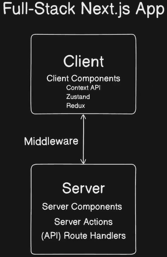

This is an example of a pet care business management app.

It is bootstrapped with [`create-next-app`](https://github.com/vercel/next.js/tree/canary/packages/create-next-app).

## Getting Started

First, run the development server:

```bash
npm run dev
```

Open [http://localhost:3000](http://localhost:3000) with your browser to see the result.

## Shadcn UI

It uses Shadcn for UI components

```bash
npx shadcn@3.6.2 init
```

This creates a components.json file with all installed shadcn components
It also creates a src/lib/utils.ts file with the cn utility function
which combines clsx for defining conditional class names and tailwind-merge
for merging Tailwind CSS class names in an intuitive way.

to add more shadcn components, run

```bash
npx shadcn@3.6.2 add <component-name>
```

We have added the following shadcn components:

- Button
- Card
- Dialog
- Label
- Input
- Textarea
- Sonner (toast notifications)

All components are stored in the src/components/ui folder.

The advantage of using shadcn is that you get the source code for all components
locally so you can customise them. We changed the following defaults:

- after installing the button component src/components/ui/button.tsx
  - changed the style of all buttonVariants to rounded-full instead of rounded-md to make the buttons more rounded.
  - changed size for default to h-10 from h-11 and px-6 from px-4.
  - changed variants:size:icon to h-14 w-14 to make icon buttons larger
  - changed the colour of secondary buttons to be darker, the tailwind config references a --secondary CSS variable in this case which is defined in src/styles/globals.css. And it's defined in HSL format so changed the lightness 95.9% to 85% to make it darker.

Also note the chadcn uses radix-ui under the hood for accessibility and headless components. The are headless because they don't come with any styling, they provide behaviours like trapping focus in modals, or keyboard navigation in dropdowns. But shadcn adds styling on top of that.

## Next.js client server architecture



## Tailwind design system

This project uses Tailwind CSS for styling. The design system is defined in the tailwind.config.ts file by adding to the theme.extend section.

We added to 'colors', a new key 'light' with the value 'rgba(0, 0, 0, 0.08)' which is used for borders and other UI elements to provide a subtle shadow effect. The last value is the opacity, so this represents black at 8% opacity.

# Persistance

Using Postgres as the database in production but sqlite initially to simplify dev with Prisma as the ORM.

First make sure we can run typescript files with tsx

```bash
npm i typescript tsx @types/node --save-dev
```

Install prisma packages:

```bash
npm install prisma @types/node @types/pg --save-dev
npm install @prisma/client @prisma/adapter-pg pg dotenv
```

Then initialize prisma with an sqlite datasource for development:

```bash
npx prisma init --datasource-provider sqlite
```

Create the initial model in the prisma/schema.prisma file

Push the prisma schema to the database:

```bash
npx prisma db push
```

If you want to track changes use migrations instead:

```bash
npx prisma migrate dev --name init
```

While developing it's easier to make rapid changes with push.

Open prisma studio to check the tables are created in the database:

```bash
npx prisma studio
```

Generate the prisma client after making changes to the schema:

```bash
npx prisma generate
```

To use better-sqlite3, the driver from the javascript ecosystem instead of the prisma driver, install the adapter

```bash
npm install @prisma/adapter-better-sqlite3
```

Next.js hot reloading can create multiple instances of the Prisma Client, to avoid this create a singleton instance of the Prisma client as described here https://www.prisma.io/docs/orm/more/help-and-troubleshooting/nextjs-help. Note at the time of writing the docs were out of date, they create a PrismaClient with no arguments, but we need to pass in the driver adapter now as described here https://www.prisma.io/docs/orm/more/upgrade-guides/upgrading-versions/upgrading-to-prisma-7#driver-adapters-and-client-instantiation

The singleton prisma client has been created in src/lib/db.ts

We created a seed script to populate initial data in prisma/seed.ts
We could run the seed script directly with tsx prisma/seed.ts, but to integrate with prisma we added the following to the package.json scripts section:
"scripts": {
...
"db:seed": "prisma db seed"
}

Also updated the prisma.config.ts file to use tsx to run the seed script:
migrations: {
...
seed: 'tsx prisma/seed.ts',
}

Now we can run the seed script with

```bash
npm run db:seed
```

# Authentication

Using next-auth for authentication for example purposes. Would be better to use something like Auth0, Kinde Auth or Clerk in production.

Also use JWT (JSON Web Tokens) rather than database sessions to avoid extra database calls. The downside is that after login all JWT data is stored in the client so its harder to revoke access before the token expires. However checking the database every time adds overhead but makes it easier to revoke access (by deleting the session in the database). There are solutions that use a combination of both (e.g. https://clerk.com/blog/combining-the-benefits-of-session-tokens-and-jwts). For simplicity this project uses JWT only.
